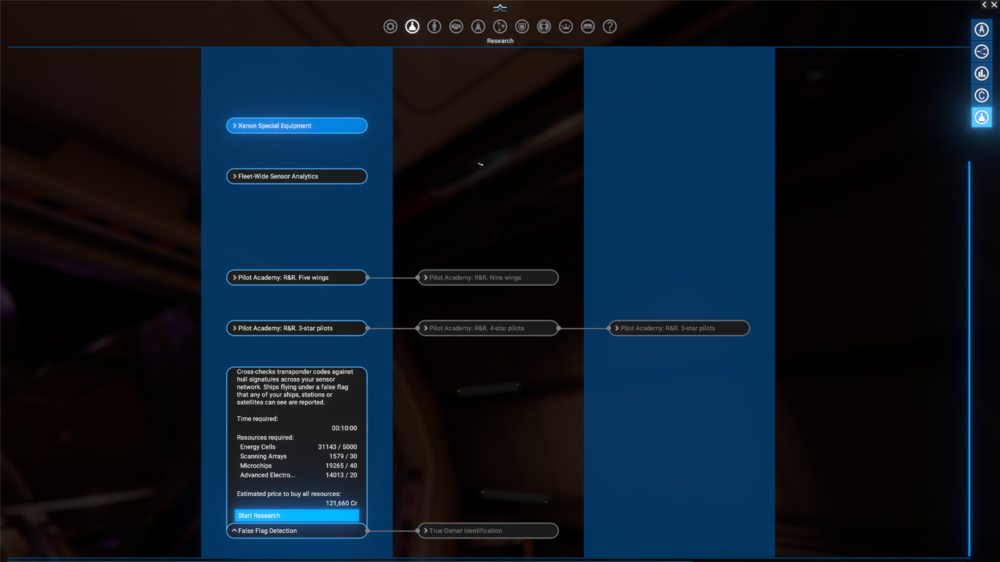
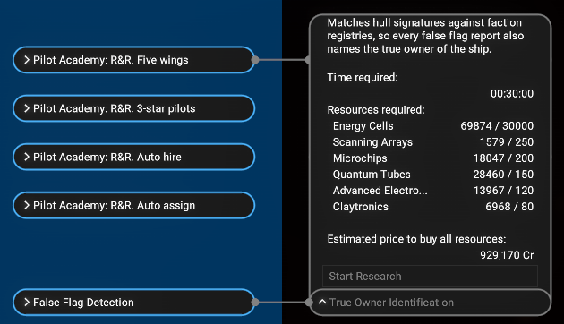
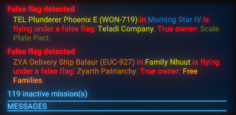
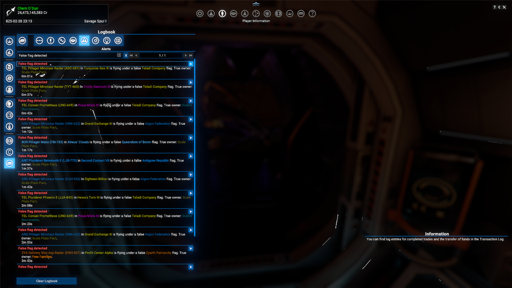
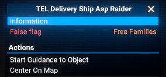
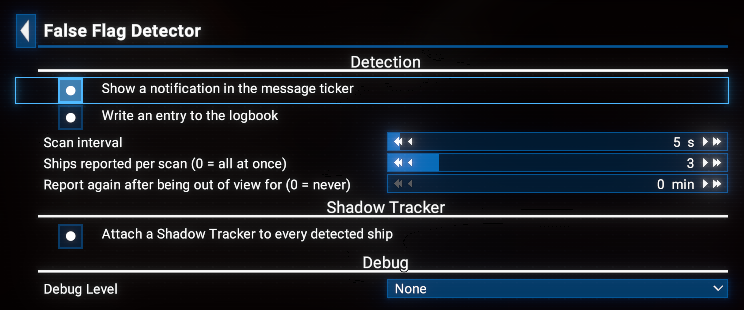

# False Flag Detector

Pirates and smugglers often fly under someone else's flag: a Scale Plate trader entering Teladi space shows up as a Teladi ship, and nothing on the map tells you otherwise. This extension adds two research projects that let your sensor network spot them.

## Features

- **False Flag Detection** research: any ship flying under a false flag that one of your ships, stations or satellites can see is reported, with its name, ID, sector and the flag it shows.
- **True Owner Identification** research: a more expensive follow-up; every report also names the true owner of the ship.
- **Context menu**: right-click a detected ship to see a **False flag** line; with True Owner Identification researched, the true owner is shown beside it in its faction colour. Hover over it for the full report.
- **Notifications**: a warning in the ticker and an entry in the logbook's Alerts, each can be switched off. For 10 minutes after the report the logbook entry shows the ship on the map; a ship carrying a Shadow Tracker keeps that button.
- **Shadow Tracker**: with [Shadow Tracker](https://steamcommunity.com/sharedfiles/filedetails/?id=3676424693) installed and the option on, a Shadow Tracker device is attached to every detected ship while you have free devices in your inventory.

## Limitations

- A ship is reported once per disguise: again when it switches to another false flag, or drops its flag and later takes one again. A ship that leaves your sensor coverage and comes back under the same flag is reported again only when **Report again after being out of view for** is set.
- Detection only names the ship. To expose it in the game, scan it as usual: a finished scan strips the false flag, and the local forces can respond.
- Your own ships flying under a cover faction are never reported.

## Requirements

- **X4: Foundations**: Version **8.00** or higher.
- **Mod Support APIs**: Version **1.95** or higher by [SirNukes](https://next.nexusmods.com/profile/sirnukes?gameId=2659).
  - Available on Steam: [SirNukes Mod Support APIs](https://steamcommunity.com/sharedfiles/filedetails/?id=2042901274)
  - Available on Nexus Mods: [Mod Support APIs](https://www.nexusmods.com/x4foundations/mods/503)
- **Options Helper**: Version **1.10** or higher by [Chem O`Dun](https://next.nexusmods.com/profile/ChemODun/mods?gameId=2659).
  - Available on Steam: [Options Helper](https://steamcommunity.com/sharedfiles/filedetails/?id=3715253556)
  - Available on Nexus Mods: [Options Helper](https://www.nexusmods.com/x4foundations/mods/2155)
- **Print Extension List**: Version **1.00** or higher by [Chem O`Dun](https://next.nexusmods.com/profile/ChemODun/mods?gameId=2659).
  - Available on Steam: [Print Extension List](https://steamcommunity.com/sharedfiles/filedetails/?id=3770927339)
  - Available on Nexus Mods: [Print Extension List](https://www.nexusmods.com/x4foundations/mods/2191)
- **Shadow Tracker** (optional): Version **8.00.04** or higher by [Chem O`Dun](https://next.nexusmods.com/profile/ChemODun/mods?gameId=2659).
  - Available on Steam: [Shadow Tracker](https://steamcommunity.com/sharedfiles/filedetails/?id=3676424693)
  - Available on Nexus Mods: [Shadow Tracker](https://www.nexusmods.com/x4foundations/mods/2000)

## Installation

You can download the latest version via Steam client - [False Flag Detector](https://steamcommunity.com/sharedfiles/filedetails/?id=3820999285)
Or you can do it via the Nexus Mods - [False Flag Detector](https://www.nexusmods.com/x4foundations/mods/2462)

## Save state

**No** (removing the extension does not break saves).

## Usage

Research **False Flag Detection** at your headquarters. From then on the detector checks every few seconds which ships under a false flag are seen by any of your assets, and reports the new ones. Research **True Owner Identification** afterwards to see who really owns them.

Each detected ship is reported in the message ticker:

and in the Alerts section of the logbook, with a button to show the ship on the map. The button disappears 10 minutes after the report, so an old entry does not keep revealing where the ship is now; it stays for a ship that carries a Shadow Tracker:

While a detected ship is in view or carries a Shadow Tracker, its context menu carries a **False flag** line with the true owner beside it; hover over the line for the full report:

## Options

An options page is available via the `Extension Options` menu:

- **Show a notification in the message ticker** - on by default.
- **Write an entry to the logbook** - on by default.
- **Scan interval** - how often the detector checks, from 3 to 60 seconds - 5 by default.
- **Ships reported per scan** - at most this many new ships are reported by one scan; the others wait for the next scans, so a sensor network that suddenly sees many disguised ships does not flood the logbook. 0 reports all of them at once - 3 by default.
- **Report again after being out of view for** - a ship that comes back into view under the same false flag after at least this many minutes out of view is reported again, from 0 to 120 minutes; 0 never reports it again - 0 by default.
- **Attach a Shadow Tracker to every detected ship** - off by default; available only with Shadow Tracker 8.00.04 or newer, which lets other extensions request tracking.
- **Debug Level** - None, Debug or Trace; writes detailed lines to the game log.

## Credits

- Author: Chem O`Dun, on [Nexus Mods](https://next.nexusmods.com/profile/ChemODun/mods?gameId=2659) and [Steam Workshop](https://steamcommunity.com/id/chemodun/myworkshopfiles/?appid=392160)
- *"X4: Foundations"* is a trademark of [Egosoft](https://www.egosoft.com).

## Acknowledgements

- [EGOSOFT](https://www.egosoft.com) for the X series.
- [SirNukes](https://next.nexusmods.com/profile/sirnukes?gameId=2659) for the Mod Support APIs.

## Changelog

### [1.00] - 2026-10-16

- **Added**
  - Initial public version
